  

# 🚀 Awesome AI Code Generation & Developer Tools 

  
  
  
  
  
  
  

---

## 🌟 Top AI Code Generation & Developer Tools Ecosystem

> **Curated directory of top-tier SaaS platforms and open-source GitHub projects powering autonomous coding harnesses, AI-native IDEs, local/free LLM bridges, IDE copilots, and self-hosted code intelligence.**  
> 
> *Comprehensive benchmark covering company valuations, ARR milestones, starting tier pricing, and free tier limits.*

**📅 Last updated: November 2026**

This repository tracks notable **SaaS platforms** and **open-source projects** in the rapidly expanding **AI Code Generation & Developer Tools** landscape. These systems provide real-time inline code completion, multi-file autonomous refactoring, local/free LLM API routing for coding agents, codebase-wide semantic indexing, and automated pull-request workflows.

---

## 📑 Table of Contents

- [📊 Sector Overview & Market Dynamics](#-sector-overview--market-dynamics)
- [💼 SaaS/Hosted Platforms](#-saashosted-platforms)
- [🔓 Open-Source GitHub Projects](#-open-source-github-projects)
- [⭐ Star History](#-star-history)
- [🤝 Support & Sponsoring](#-support--sponsoring)
- [🛠️ How to Contribute](#-how-to-contribute)
- [⚖️ Disclaimer](#-disclaimer)

---

## 📊 Sector Overview & Market Dynamics

The global AI code generation and developer tools market reached an estimated **$7.0 billion to $11.8 billion in 2025** and is projected to expand to **$9.5 billion to $16.1 billion in 2026**, progressing at a rapid compound annual growth rate (CAGR) exceeding **25%–35%**. 

The sector exhibits **moderate-to-high fragmentation** at the application tier—characterized by intense, head-to-head competition between established cloud incumbents (Microsoft/GitHub, AWS) and high-velocity AI-native challengers (Cursor/Anysphere, Replit, Windsurf)—while displaying concentrated "winner-take-most" network effects around foundational model backbones, proprietary context/indexing graphs, and dominant IDE distribution channels.

---

## 💼 SaaS/Hosted Platforms

The following table provides detailed pricing, free tier limits, company scale, and valuation for the leading SaaS AI coding assistants. Sorted in descending order by **Company Size / Valuation / ARR**.

| Product | Company Size / Valuation / ARR | Starting Tier Pricing | Free Tier Limit | Key Highlights |
| :--- | :--- | :--- | :--- | :--- |
| **[Amazon Q Developer](https://amazon.com)** | **$2.2T+ Market Cap** (Amazon / AWS Parent) | **$19/user/month** (Amazon Q Developer Pro) | **Perpetual Free Tier**: 50 agentic requests/month, 1,000 lines of code transformation/month, and 50 security scans/month via AWS Builder ID | Cloud AI software development assistant providing IDE code generation, automated runtime upgrades, security vulnerability scanning, and AWS troubleshooting. |
| **[GitHub Copilot](https://github.com)** | **$3.1T+ Market Cap** (Microsoft Parent) / **$1B+ ARR** (GitHub Copilot ecosystem) | **$10/month** or **$100/year** (Copilot Pro) | **Copilot Free**: 2,000 code completions/month and 50 chat messages/month | Industry-standard AI pair programmer offering inline autocomplete, multi-file Copilot Edits, autonomous GitHub issue/PR execution, and enterprise IP indemnity. |
| **[Cursor](https://cursor.com)** | **$29.3B Valuation** (Series D) / **$1B+ ARR** | **$20/month** (Cursor Pro) | **Hobby Plan**: 2,000 completions/month, 50 slow premium requests/month, and unlimited basic completions | AI-native code editor forked from VS Code featuring predictive Tab autocomplete, codebase-wide RAG indexing, Composer multi-file agents, and background execution. |
| **[Replit Agent](https://replit.com)** | **$3.0B Valuation** (Series C) / **~$250M ARR** | **$20/month** (Replit Core billed annually at $240/yr) | **Starter Plan**: 1 published app (with "Made with Replit" badge, sleeps after 5 mins of inactivity), shared CPU/512MB RAM, and 1,200 dev minutes/month | Cloud collaborative IDE and autonomous software creation agent capable of planning, coding, debugging, and deploying full-stack apps from natural language. |
| **[Windsurf (formerly Codeium)](https://windsurf.com)** | **$2.4B+ Enterprise / Licensing Valuation** (Series C @ $1.25B; $2.4B Google/Cognition transaction) / **~$82M ARR** | **$15/month** or **$10/month** billed annually (Pro Plan) | **Free Forever Tier**: Unlimited Supercomplete tab autocompletions & inline edits; capped at 25 Cascade Flow Actions/month | Agentic AI IDE and extension suite powered by Cascade flows, deep contextual awareness, live terminal synchronization, and ultra-low-latency completions. |
| **[Sourcegraph Cody](https://sourcegraph.com)** | **$2.6B Valuation** (Series D) / **~$50M ARR** | **$19/user/month** (Sourcegraph Enterprise Cody) | **14-day free trial** of Enterprise Cody with full multi-repo context access (standalone free tier discontinued) | Enterprise AI coding assistant leveraging Sourcegraph's code graph and multi-repository search for context-aware chat, inline edits, and unit test synthesis. |
| **[Augment Code](https://augmentcode.com)** | **$977M Valuation** (Series B) / **~$20M ARR** (Acquired core assets by Harness) | **$20/month** (Includes $20 pooled usage credit pool across team seats) | **14-day free trial** with credit pool (credit card verification required; no perpetual free plan) | Enterprise AI software engineering platform engineered with real-time codebase context engines for massive monorepos and autonomous task execution. |
| **[Tabnine](https://tabnine.com)** | **~$102M Raised / ~$80M+ Valuation** (Acquired by Tricentis) / **~$27M ARR** | **$39/user/month** billed annually (Tabnine Code Assistant) | **14-day free trial** of enterprise features (permanent basic free plan discontinued) | Enterprise-focused AI code generation platform emphasizing zero-data-retention privacy, air-gapped VPC deployments, custom fine-tuning, and compliance security. |
| **[Supermaven](https://supermaven.com)** | **$12M Raised** (Acquired by Cursor / Anysphere) | **$10/month** (Supermaven Pro) | **Free Plan**: Unlimited standard-speed inline code completions with 7-day data retention (excludes 1M-token context & style adaptation) | Ultra-low-latency AI code completion platform built around a 1-million-token context window (Babble) for near-instantaneous inline suggestions. |
| **[Continue.dev Hub (Cloud)](https://continue.dev)** | **$5.6M Raised** (Acquired by Cursor / Anysphere) | **$10/developer/month** (Team Hub) | **Free Forever (Solo Hub)**: Unlimited local usage, unlimited BYOM/BYOK API connections, public agent sharing, and community configs | Cloud hub and team governance layer for the open-source Continue IDE extension enabling shared custom assistants, MCP configurations, and model routing. |

---

## 🔓 Open-Source GitHub Projects

Explore the top open-source autonomous coding agents, terminal CLIs, AI-native editors, and local LLM routers. Ranked in descending order by **GitHub Stars_Count**.

| Project | GitHub_Stars | License | Description |
| :--- | :--- | :--- | :--- |
| **[OpenCode](https://github.com/anomalyco/opencode)** |  | `MIT` | Modern terminal-native AI coding agent featuring a polished TUI, LSP diagnostics integration, client/server architecture, and multi-provider LLM support. |
| **[AutoGPT](https://github.com/Significant-Gravitas/AutoGPT)** |  | `MIT` | Autonomous general-purpose agent toolkit capable of recursive task execution, internet browsing, codebase synthesis, and file generation. |
| **[Ollama](https://github.com/ollama/ollama)** |  | `MIT` | Universal open-source local inference runtime allowing developers to run coding models (Qwen2.5-Coder, DeepSeek-Coder, Llama 3) entirely offline. |
| **[Zed Editor](https://github.com/zed-industries/zed)** |  | `GPL-3.0` / `Apache-2.0` | High-performance Rust code editor featuring native Agentic Editing, Edit Prediction (`Zeta` open model), and multi-buffer AI workflows. |
| **[OpenHands](https://github.com/OpenHands/OpenHands)** |  | `MIT` | Autonomous software-engineering agent platform operating inside sandboxed Docker containers with full bash, code editor, and web browser capabilities. |
| **[Cline](https://github.com/cline/cline)** |  | `Apache-2.0` | Autonomous coding agent for VS Code capable of creating/editing files, running terminal commands, inspecting browsers, and connecting to MCP servers with approval. |
| **[Alishahryar1/free-claude-code](https://github.com/Alishahryar1/free-claude-code)** |  | `Open Source` | Local proxy and provider router enabling developers to run Anthropic's Claude Code CLI seamlessly against free-tier APIs (NVIDIA NIM, OpenRouter, Groq) and local models. |
| **[LiteLLM](https://github.com/BerriAI/litellm)** |  | `MIT` | Unified I/O proxy interface to call 100+ LLM APIs using standard OpenAI format; widely used as routing layer for AI coding harnesses and copilot extensions. |
| **[Goose](https://github.com/block/goose)** |  | `Apache-2.0` | Extensible local-first AI developer agent from Block supporting autonomous shell execution, multi-file code editing, and Model Context Protocol (MCP) toolkits. |
| **[Aider](https://github.com/Aider-AI/aider)** |  | `Apache-2.0` | Pioneering terminal AI pair-programming tool that maps entire Git repositories, applies multi-file edits, runs linters/tests, and auto-generates git commits. |
| **[Claude Code Router](https://github.com/musistudio/claude-code-router)** |  | `MIT` | Lightweight gateway routing Claude Code CLI requests to OpenRouter, DeepSeek, Ollama, Gemini, and custom local OpenAI-compatible endpoints. |
| **[Continue](https://github.com/continuedev/continue)** |  | `Apache-2.0` | Open-source AI code assistant extension for VS Code and JetBrains enabling custom autocomplete, chat, and agent workflows backed by any local or cloud LLM. |
| **[Tabby](https://github.com/TabbyML/tabby)** |  | `Apache-2.0` | Self-hosted AI coding assistant written in Rust offering repository-level RAG, FIM (Fill-in-the-Middle) autocomplete, and extensions for VS Code, Vim, and IntelliJ. |
| **[Serena](https://github.com/oraios/serena)** |  | `MIT` | Language Server Protocol (LSP) Model Context Protocol (MCP) server providing precise symbol definition, references, and workspace navigation for coding agents. |
| **[Void](https://github.com/voideditor/void)** |  | `Apache-2.0` | Open-source alternative to Cursor built on VS Code providing inline diffs, codebase indexing, agentic file editing, and direct connection to local/commercial models. |
| **[Kilo Code](https://github.com/Kilo-Org/kilocode)** |  | `Apache-2.0` | Unified VS Code AI coding agent merging the best capabilities of Cline, Roo Code, and Continue with built-in model routing and automated refactoring. |
| **[Tree-sitter](https://github.com/tree-sitter/tree-sitter)** |  | `MIT` | Incremental parsing system generating syntax trees used across AI code editors for AST-aware code transformations and semantic chunking. |
| **[Roo Code](https://github.com/RooCodeInc/Roo-Code)** |  | `Apache-2.0` | Feature-rich fork of Cline offering customizable agent modes (`Architect`, `Code`, `Debug`, `Orchestrator`), Boomerang sub-tasks, and model routing. |
| **[SWE-agent](https://github.com/SWE-agent/SWE-agent)** |  | `MIT` | Autonomous GitHub issue resolution agent from Princeton NLP equipped with custom Agent-Computer Interfaces (ACI) for repository navigation and patch generation. |
| **[Avante.nvim](https://github.com/yetone/avante.nvim)** |  | `Apache-2.0` | Neovim plugin replicating the Cursor AI IDE experience inside Vim with side-by-side diff previews, agentic tool calling, and multi-model support. |
| **[Qwen2.5-Coder / Qwen3-Coder](https://github.com/QwenLM/Qwen2.5-Coder)** |  | `Apache-2.0` | High-accuracy open-weight code LLM series matching proprietary models on coding benchmarks, optimized for local inference with Ollama/vLLM. |
| **[PR-Agent / Qodo Merge](https://github.com/qodo-ai/pr-agent)** |  | `Apache-2.0` | AI-powered pull request reviewer and developer tool providing automated code walkthroughs, bug detection, test suggestions, and `/improve` PR actions. |
| **[Sweep](https://github.com/sweepai/sweep)** |  | `Apache-2.0` | AI junior developer that turns GitHub issues and bug reports into automated pull requests with unit tests and file edits. |
| **[CodeCompanion.nvim](https://github.com/olimorris/codecompanion.nvim)** |  | `MIT` | Extensible AI coding plugin for Neovim supporting inline transformations, agentic slash commands, MCP servers, and local/cloud adapters. |
| **[Twinny](https://github.com/twinnydotdev/twinny)** |  | `MIT` | Privacy-first VS Code extension designed for local Ollama, llama.cpp, and LM Studio inference with zero telemetry, FIM autocomplete, and RAG chat. |
| **[Refact.ai](https://github.com/smallcloudai/refact)** |  | `BSD-3-Clause` | Self-hostable AI coding engine supporting local fine-tuning, AST-aware code completion, and autonomous bug-fixing agents. |

---

## 📈 Star History

---

## 💖 Support & Sponsoring

If you found this curated list helpful for discovering developer tools, comparing AI coding harnesses, or architecting your team's software engineering workflows, please consider supporting the project!

- ⭐ **Star this repository** to help other engineers and developers discover it.
- 🍴 **Fork the repo** to keep a personal copy or contribute your own tool additions.
- 📢 **Share with your colleagues and developer community** on Twitter/X, LinkedIn, Reddit, or Discord.
- ☕ **Buy me a coffee / Sponsor**: If you'd like to back ongoing research and curation, feel free to sponsor via the [GitHub Sponsor Dashboard](https://github.com/sponsors/ishandutta2007). Your support is greatly appreciated!

---

## 🛠️ How to Contribute

Contributions are warmly welcomed! To suggest a new tool or suggest updates:

1. **Fork** the repository.
2. Create a new feature branch (`git checkout -b feature/add-new-tool`).
3. Add the SaaS product or Open-Source project to the appropriate table maintaining alphabetical or metric-based sorting.
4. Verify that links are live and factual.
5. Commit your changes (`git commit -m "Add NewTool to AI Developer Tools List"`).
6. Push to your branch and open a **Pull Request**.

---

## ⚖️ Disclaimer

*All trademarks, logos, and brand names are the property of their respective owners. Listing in this repository does not imply formal endorsement. Market valuations, revenues, and pricing structures are derived from publicly available financial data, funding announcements, and official vendor pricing portals, and may be subject to revision by vendors over time.*
